# PathFinder AI — Sistem Mimarisi

> **Sahibi:** Şilan Aybek (System Architect) · **Danışman:** Dr. Sibel Boran
> **Kapsam:** Tüm sistem (client, server, veritabanı, öneri motoru, AI-ML modülü)
> **İlgili dokümanlar:** [README.md](README.md) · [BACKEND.md](BACKEND.md) · [AUTH.md](AUTH.md) · [AI-ML/README.md](AI-ML/README.md)

Bu doküman PathFinder AI'ın **nasıl parçalara ayrıldığını, parçaların birbiriyle nasıl konuştuğunu ve neden böyle tasarlandığını** anlatır. Endpoint ayrıntıları için BACKEND.md, kimlik doğrulama ayrıntıları için AUTH.md esas alınır; burada tekrar edilmez.

---

## İçindekiler

1. [Amaç ve kalite hedefleri](#1-amaç-ve-kalite-hedefleri)
2. [Sistem bağlamı](#2-sistem-bağlamı)
3. [Konteyner görünümü](#3-konteyner-görünümü)
4. [Bileşen görünümü](#4-bileşen-görünümü)
5. [Çalışma zamanı akışları](#5-çalışma-zamanı-akışları)
6. [Veri mimarisi](#6-veri-mimarisi)
7. [Öneri motoru mimarisi](#7-öneri-motoru-mimarisi)
8. [AI-ML modülü ve entegrasyon planı](#8-ai-ml-modülü-ve-entegrasyon-planı)
9. [Dağıtım (deployment) görünümü](#9-dağıtım-deployment-görünümü)
10. [Kesişen konular](#10-kesişen-konular)
11. [Mimari kararlar (ADR)](#11-mimari-kararlar-adr)
12. [Riskler ve teknik borç](#12-riskler-ve-teknik-borç)
13. [Mimari yol haritası](#13-mimari-yol-haritası)

---

## 1. Amaç ve kalite hedefleri

PathFinder AI, üniversite mezunlarının **bölüm, beceri ve ilgi alanlarını** kariyer gereksinimleriyle karşılaştırıp **kariyer önerisi, açıklama ve beceri yol haritası** üreten bir web uygulamasıdır.

| Öncelik | Kalite hedefi | Mimarideki karşılığı |
| --- | --- | --- |
| 1 | **Güvenilirlik** — AI servisi çökse de kullanıcı sonuç alır | Kural tabanlı motor her zaman çalışır; AI yalnızca üst katman (timeout + fallback) |
| 2 | **Doğruluk / açıklanabilirlik** — öneriler uydurma olmamalı | AI sadece küratörlü kısa listeden seçebilir; çıktısı doğrulanır |
| 3 | **Güvenlik** — kullanıcı verisi korunur | JWT, bcrypt, parametreli SQL, rate limit, hata detaylarının gizlenmesi |
| 4 | **Geliştirilebilirlik** — 6 kişilik ekip paralel çalışabilir | Katmanlı yapı (`routes` / `services` / `db`), monorepo workspace'leri |
| 5 | **Düşük maliyet** — öğrenci projesi bütçesi | AI opsiyonel, cache'li; tek PostgreSQL; ek altyapı yok |

**Kısıtlar:** 10 haftalık takvim, Node.js + React + PostgreSQL yığını, AI için harici API (OpenAI / Gemini), API anahtarı olmadan da geliştirilebilir olma şartı.

---

## 2. Sistem bağlamı

Sistemin dış dünyayla ilişkisi:

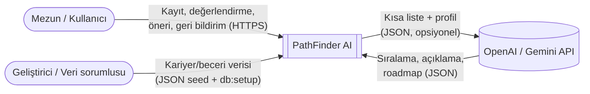

| Aktör / sistem | Rol |
| --- | --- |
| **Mezun** | Hesap açar, değerlendirmeyi doldurur, önerileri görür ve puanlar |
| **Geliştirici / veri sorumlusu** | `server/data/*.json` içindeki kariyer–beceri verisini günceller |
| **OpenAI / Gemini** | Opsiyonel. Kısa listeyi sıralar ve doğal dilde açıklama üretir. Sistem bu olmadan da tam çalışır |

---

## 3. Konteyner görünümü

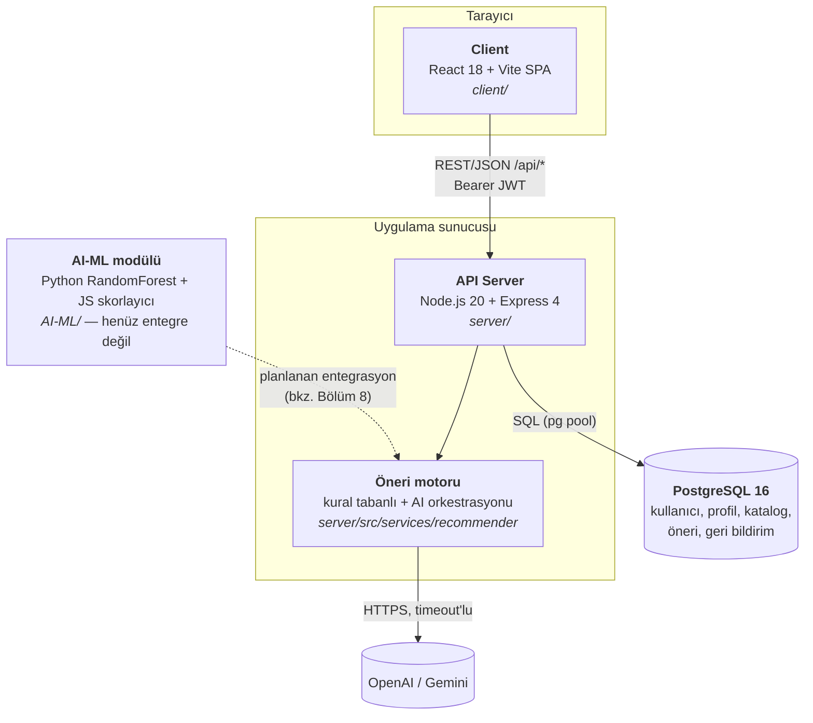

| Konteyner | Teknoloji | Sorumluluk | Port (geliştirme) |
| --- | --- | --- | --- |
| Client | React 18, React Router 6, Vite 5 | Arayüz, form doğrulama, token saklama | `5173` |
| API Server | Node.js 20.12+, Express 4, ES modules | Kimlik doğrulama, iş kuralları, kalıcılık, öneri üretimi | `4000` |
| Öneri motoru | Saf JS modülleri (API sürecinin içinde) | Skorlama, roadmap, AI çağrısı, doğrulama, cache | — |
| Veritabanı | PostgreSQL 16 (Docker) | Kalıcı veri | `5432` |
| AI-ML modülü | Python (scikit-learn), Node.js | Ayrı bir deney alanı; API'ye bağlı değil | — |

Geliştirmede Vite, `/api` isteklerini `localhost:4000`'e proxy'ler (`client/vite.config.js`); bu sayede tarayıcı tek origin görür ve CORS sorunu yaşanmaz.

---

## 4. Bileşen görünümü

### 4.1 API Server

Katmanlı bir yapı vardır; bağımlılıklar yalnızca **yukarıdan aşağıya** akar.

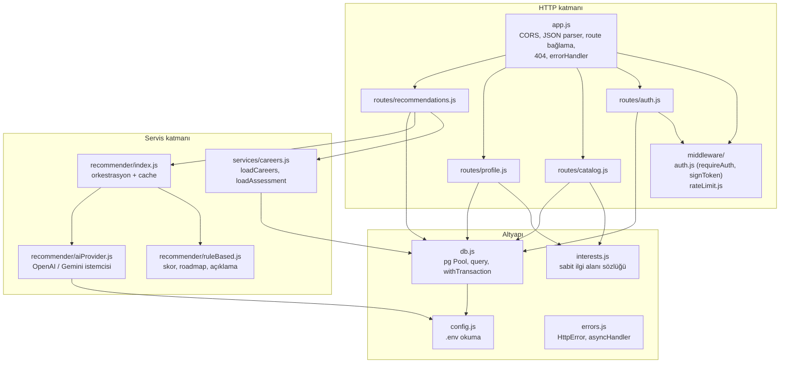

| Bileşen | Sorumluluk | Not |
| --- | --- | --- |
| `routes/*` | Girdi doğrulama, HTTP durum kodları, servisleri çağırma | İş mantığı içermemeli |
| `middleware/auth.js` | JWT üretme/doğrulama, `req.userId` doldurma | Stateless |
| `middleware/rateLimit.js` | IP başına sabit pencere limiti (login/register) | Bellek içi |
| `services/careers.js` | Katalog ve kullanıcı değerlendirmesini motorun beklediği şekle çevirme | Tek SQL ile kariyer + beceri + ortalama puan |
| `recommender/index.js` | Kısa liste → AI → doğrulama → cache → fallback | Motorun tek giriş noktası: `recommend()` |
| `recommender/ruleBased.js` | Deterministik skorlama ve roadmap | Saf fonksiyon, DB'ye dokunmaz, test edilebilir |
| `recommender/aiProvider.js` | LLM sağlayıcısına istek, `AbortController` ile timeout | Sağlayıcı eklemek bu dosyayla sınırlı |
| `errors.js` | Tek tip hata formatı `{ error, details }` | 500'lerde detay yalnızca loga gider |

### 4.2 Client

| Bileşen | Sorumluluk |
| --- | --- |
| `main.jsx`, `App.jsx` | Router, üst menü, `RequireAuth` koruması |
| `AuthContext.jsx` | Oturum durumu; token `localStorage` içinde, açılışta `/auth/me` ile doğrulanır |
| `api.js` | Tek `fetch` sarmalayıcısı; token ekler, hataları `ApiError`'a çevirir |
| `pages/Assessment.jsx` | Bölüm, mezuniyet yılı, ilgi alanları ve beceri seviyeleri formu → `PUT /profile` |
| `pages/Results.jsx` | Öneri kartları, roadmap, puanlama → `/recommendations*` |
| `pages/Login`, `Register`, `AuthTest` | Kimlik doğrulama ekranları ve test sayfası |

---

## 5. Çalışma zamanı akışları

### 5.1 Kayıt / giriş

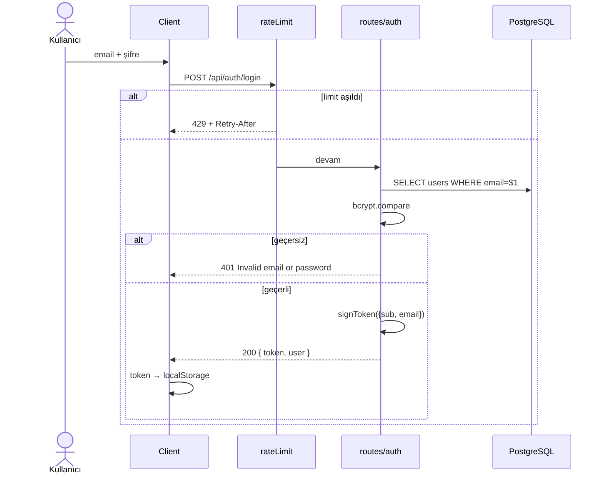

### 5.2 Değerlendirmeyi kaydetme

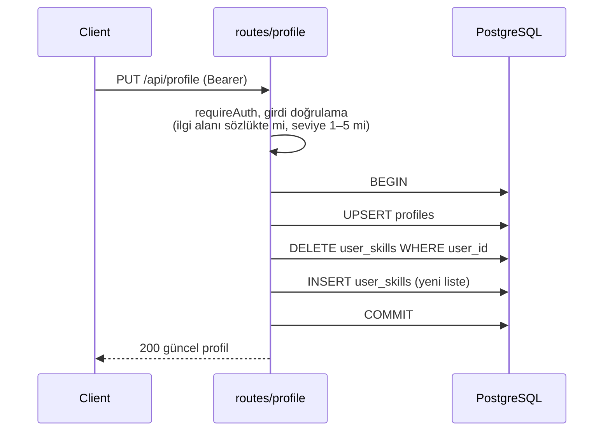

Beceri listesi **tamamen değiştirilir** (replace semantiği). Tüm yazmalar tek transaction içindedir; yarım kalmış profil oluşmaz.

### 5.3 Öneri üretme (AI açık / kapalı)

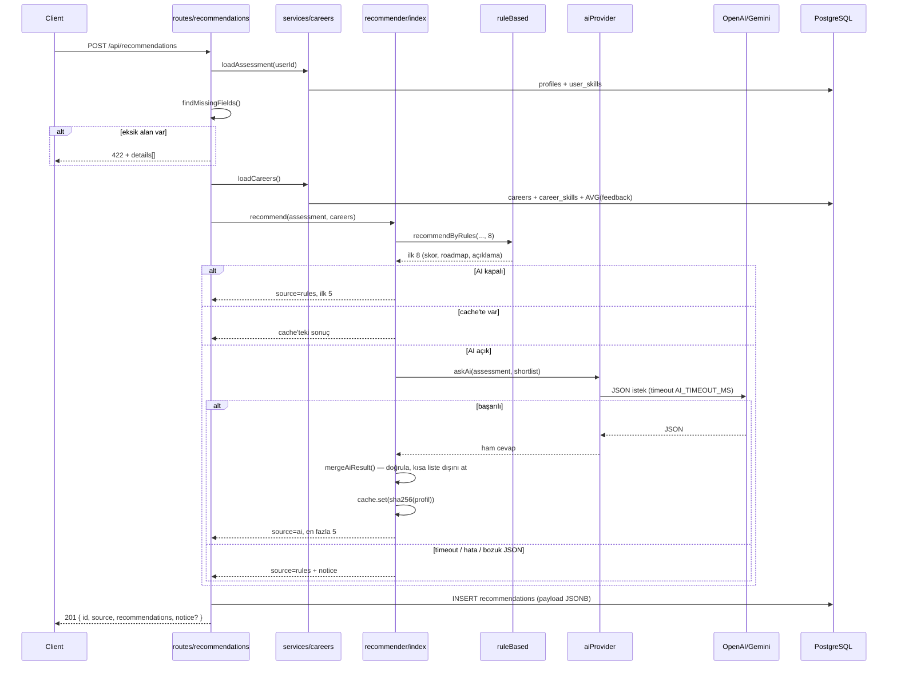

### 5.4 Geri bildirim döngüsü

Kullanıcı bir öneriyi 1–5 arası puanlar (`POST /recommendations/:id/feedback`). Sunucu, puanlanan kariyerin gerçekten o öneride yer aldığını kontrol eder ve `(recommendation_id, career_id)` için upsert yapar. Sonraki öneri isteğinde `loadCareers()` her kariyerin ortalama puanını getirir ve kural motoru skoru **en fazla ±5 puan** kaydırır. Böylece sistem, kullanıcı geri bildiriminden kontrollü biçimde öğrenir; tek bir kullanıcı sonuçları domine edemez.

---

## 6. Veri mimarisi

### 6.1 Varlık–ilişki modeli

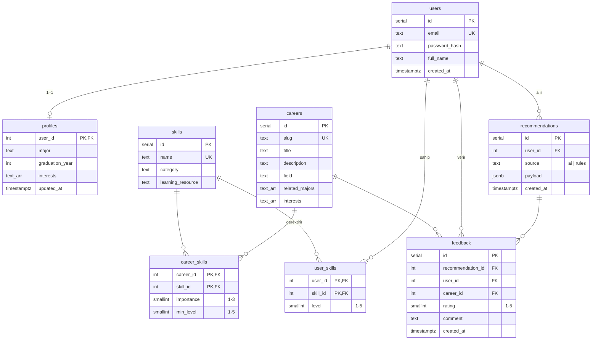

### 6.2 Veri sınıfları

| Sınıf | Tablolar | Kaynak | Yaşam döngüsü |
| --- | --- | --- | --- |
| **Referans (katalog)** | `skills`, `careers`, `career_skills` | `server/data/*.json` → `npm run db:setup` (upsert) | Git'te sürümlenir; değişiklik PR ile yapılır |
| **Kullanıcı verisi** | `users`, `profiles`, `user_skills` | API | Kullanıcı silinirse `ON DELETE CASCADE` ile hepsi silinir |
| **Türetilmiş / tarihçe** | `recommendations` | Öneri motoru | Değişmez (append-only); `payload` o anki sonucun anlık görüntüsüdür |
| **Geri bildirim** | `feedback` | API | Öneri başına kariyer başına tek kayıt |

### 6.3 Tasarım notları

- **`recommendations.payload` JSONB:** Öneri o anki katalogla üretilir. Katalog sonradan değişse de kullanıcının geçmiş sonucu bozulmaz; şema değişmeden payload alanı genişletilebilir.
- **İlgi alanları `TEXT[]`:** Sabit ve küçük bir sözlük (`interests.js`, 11 değer) olduğu için ayrı tablo yerine dizi seçildi. Doğrulama uygulama katmanında yapılır.
- **Kısıtlar veritabanında:** Seviye, önem ve puan aralıkları `CHECK` ile korunur; uygulama hatası olsa bile geçersiz veri yazılamaz.
- **İndeks:** `idx_recommendations_user (user_id, created_at DESC)`, `GET /recommendations/latest` sorgusunu karşılar.

---

## 7. Öneri motoru mimarisi

Motor iki katmanlıdır. **Kural motoru temel**, AI ise **isteğe bağlı bir iyileştirme katmanıdır**.

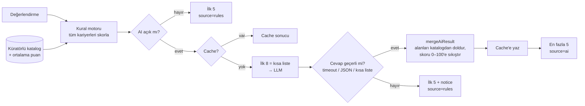

**Skor formülü** (ayrıntı BACKEND.md'de):

```
skor = 0.65 × beceri + 0.20 × ilgi + 0.15 × bölüm + geri_bildirim_düzeltmesi (±5)
```

**Güvenlik ağı (guardrail) prensipleri:**

1. LLM **katalog dışında kariyer üretemez**; kısa listede olmayan `careerId`'ler atılır.
2. Başlık, alan ve açıklama her zaman **küratörlü veriden** gelir; LLM yalnızca sıralama, açıklama ve roadmap metnine katkı verir.
3. Skor sayıya çevrilip 0–100 aralığına sıkıştırılır; roadmap en fazla 8 adımla sınırlanır.
4. Her hata durumunda kullanıcı yine sonuç alır ve `notice` alanı bunu şeffafça bildirir.

**Genişletme noktası:** Yeni bir sağlayıcı (ör. yerel model, Claude) eklemek için yalnızca `aiProvider.js` içine bir `callX()` fonksiyonu ve `config.ai` içine ayar eklenir; orkestrasyon ve doğrulama değişmez.

---

## 8. AI-ML modülü ve entegrasyon planı

`AI-ML/` klasörü (sorumlu: Elham Abdullahi Mohamed) şu an **ana uygulamadan bağımsız** bir çalışma alanıdır.

### 8.1 Mevcut durum

| Parça | İçerik | Durum |
| --- | --- | --- |
| `data/questions/*.json` | İlgi, beceri, kişilik, çalışma tarzı, kariyer hedefi soruları | Client'ta kullanılmıyor |
| `algorithms/*.js` | Cevap ağırlıklı skorlayıcı + bölüm (+15) / beceri (+5) eşleştirme, ilk 3 | API'ye bağlı değil |
| `ML/train_model.py` | 108 satırlık `dataset.csv` ile RandomForest (5 kategorik özellik) | Model eğitiliyor |
| `ML/career_model.pkl` | Eğitilmiş model | `LabelEncoder`'lar kaydedilmediği için **tahminde kullanılamıyor** |
| `ML/predict_model.py` | Yalnızca modeli yüklüyor | Tahmin yapmıyor |
| `docs/Scoring_System.md`, `model_evaluation.md` | — | **Boş** |

### 8.2 Tespit edilen uyumsuzluklar

| # | Sorun | Etkisi |
| --- | --- | --- |
| 1 | Kariyer kimlikleri farklı: server `backend-developer` (14 kariyer, kebab-case), AI-ML `software_engineer` (10 kariyer, snake_case) | İki motorun sonuçları birleştirilemez |
| 2 | Girdi modeli farklı: server **beceri seviyesi (1–5) + ilgi alanı**, AI-ML **çoktan seçmeli cevap + kişilik/çalışma tarzı** | AI-ML'nin beklediği veri API'de toplanmıyor |
| 3 | `AI-ML/package.json` içeriği köşeli parantez `[ ]` ile sarılmış, geçerli bir paket tanımı değil | `npm` komutları bu klasörde çalışmaz |
| 4 | `tests/test_algorithms.js` testi başarısız (1 fail) | AI-ML algoritmalarında regresyon |
| 5 | Model değerlendirmesi yok (train/test ayrımı, doğruluk metriği yok) | Modelin kural motorundan iyi olduğu gösterilemiyor |

### 8.3 Önerilen entegrasyon mimarisi

Hedef: AI-ML modelini **üçüncü bir sinyal** olarak motora eklemek, ama mevcut güvenilirlik prensibini bozmamak.

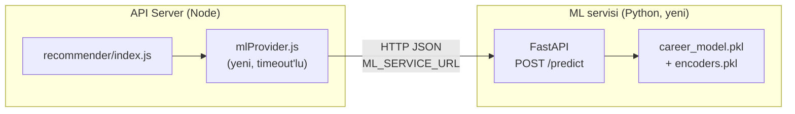

1. **Tek kariyer sözlüğü:** `server/data/careers.json` içindeki `slug`'lar tek doğruluk kaynağı (single source of truth) olur. AI-ML verisi ve `dataset.csv` bu slug'lara eşlenir.
2. **Model paketleme:** `train_model.py` model ile birlikte encoder'ları da (`encoders.pkl`) kaydeder; eğitimde train/test ayrımı yapılır ve metrikler `docs/model_evaluation.md`'ye yazılır.
3. **Ayrı Python servisi:** `predict_model.py` küçük bir FastAPI servisine dönüştürülür (`POST /predict` → `{ slug: olasılık }`). Node ile Python'u aynı süreçte çalıştırmak yerine HTTP seçilir; böylece iki ekip bağımsız deploy edebilir.
4. **Motorda ağırlıklandırma:** `mlProvider.js`, AI çağrısıyla aynı desende çalışır (timeout + fallback). Model olasılığı skora sınırlı bir ağırlıkla eklenir (ör. `0.10`). Servis yoksa ağırlık 0 kabul edilir ve sistem bugünkü gibi çalışır.
5. **Ek değerlendirme soruları opsiyonel:** Kişilik / çalışma tarzı soruları `profiles` tablosuna `answers JSONB` kolonu olarak eklenir; zorunlu alan yapılmaz, böylece mevcut 422 kuralı değişmez.

---

## 9. Dağıtım (deployment) görünümü

### 9.1 Geliştirme ortamı (mevcut)

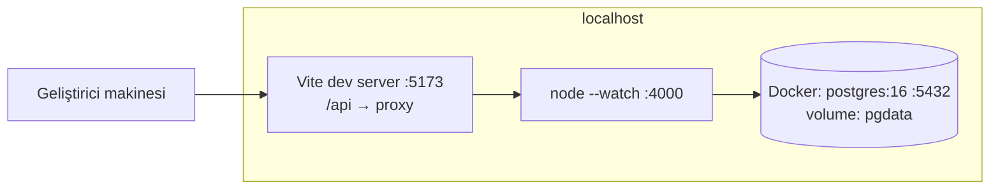

### 9.2 Önerilen üretim ortamı

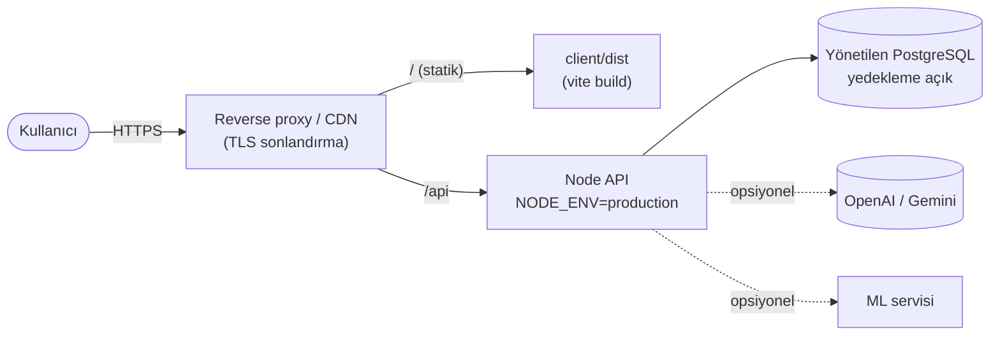

| Konu | Karar |
| --- | --- |
| Statik dosyalar | `npm run build` çıktısı CDN veya reverse proxy'den servis edilir; aynı origin olduğu için CORS gerekmez |
| Gizli bilgiler | `JWT_SECRET`, `DATABASE_URL`, API anahtarları ortam değişkeni olarak verilir; `.env` repoya girmez. `NODE_ENV=production` iken `JWT_SECRET` yoksa sunucu açılmaz |
| Proxy arkasında | Express'te `app.set('trust proxy', 1)` ayarlanmalıdır, aksi halde rate limit tüm kullanıcıları proxy IP'si olarak sayar |
| Ölçekleme | Tek instance yeterli. Birden fazla instance'a geçilirse cache ve rate limit Redis'e taşınmalıdır (bkz. Bölüm 12) |

---

## 10. Kesişen konular

### 10.1 Güvenlik

| Tehdit | Önlem | Yer |
| --- | --- | --- |
| Şifre sızıntısı | `bcryptjs` hash, şifre hiçbir cevapta dönmez | `routes/auth.js` |
| Kaba kuvvet / hesap tarama | IP başına 15 dk'da 10 deneme; login'de tek tip hata mesajı | `rateLimit.js`, AUTH.md |
| SQL injection | Yalnızca parametreli sorgular (`$1, $2`) | Kod kuralı |
| Yetkisiz erişim | `requireAuth`; sorgular her zaman `user_id = req.userId` ile filtrelenir | `routes/*` |
| Başkasının önerisini puanlama | Öneri `id` + `user_id` ile çekilir, kariyer öneride var mı kontrol edilir | `recommendations.js` |
| Büyük gövde ile DoS | `express.json({ limit: '100kb' })` | `app.js` |
| Bilgi sızıntısı | 500 hatalarında detay yalnızca loga yazılır | `errors.js` |
| LLM prompt injection / halüsinasyon | Kısa liste kısıtı + çıktı doğrulama | `recommender/index.js` |
| XSS ile token çalınması | Token `localStorage`'da tutuluyor; React varsayılan olarak çıktıyı escape eder | **Risk** — bkz. Bölüm 12 |

### 10.2 Hata yönetimi

Tüm route'lar `asyncHandler` ile sarılır ve `HttpError(status, mesaj, details)` fırlatır. Merkezi `errorHandler` tek tip `{ error, details? }` döner. Client'ta `api.js` bunu `ApiError`'a çevirir; ekranlar `status` ve `details` alanlarına göre davranır (ör. 422'de eksik alanları gösterir).

### 10.3 Konfigürasyon

Tüm ayarlar `config.js` üzerinden tek noktadan okunur; kodun başka yerinde `process.env` kullanılmaz. Varsayılanlar geliştirme için güvenli, üretim için zorunlu olanlar kontrol edilir.

### 10.4 Performans

- Öneri isteği tipik olarak 2 SQL sorgusu + bellek içi skorlama içerir (14 kariyer × 32 beceri, milisaniyeler).
- En pahalı adım LLM çağrısıdır; `AI_TIMEOUT_MS` (15 sn) ile sınırlanır ve aynı profil için `AI_CACHE_TTL_MS` (1 saat) boyunca cache'ten döner.
- `pg.Pool` bağlantıları yeniden kullanır.

### 10.5 Test stratejisi

| Seviye | Mevcut | Hedef |
| --- | --- | --- |
| Birim | `recommender.test.js`, `rateLimit.test.js` (10/10 geçiyor) | AI-ML algoritma testlerini düzelt |
| Entegrasyon | Yok | `supertest` + test veritabanı ile auth, profile, recommendations route'ları |
| Uçtan uca | Elle (AUTH.md kontrol listesi) | Kayıt → değerlendirme → öneri → puanlama senaryosu (Playwright) |

### 10.6 Gözlemlenebilirlik

Şu an yalnızca `console.log/warn` var. Önerilen minimum: istek başına süre ve durum kodu loglayan bir middleware, AI fallback sayacı ve `/api/health` endpoint'inin veritabanı bağlantısını da kontrol etmesi.

---

## 11. Mimari kararlar (ADR)

| # | Karar | Gerekçe | Alternatif / bedel |
| --- | --- | --- | --- |
| ADR-1 | **Monorepo + npm workspaces** (`client`, `server`) | Tek `npm install`, ortak scriptler, ekip tek repoda | Ayrı repolar → senkronizasyon yükü |
| ADR-2 | **Modüler monolit API** | 10 haftalık süre, küçük ekip; tek deploy birimi | Mikroservis → gereksiz karmaşıklık |
| ADR-3 | **ORM yok, düz SQL + `pg`** | Şema küçük ve stabil; sorgular okunur ve kontrol edilebilir | Migration aracı yok (bkz. Bölüm 12) |
| ADR-4 | **Stateless JWT** | Sunucuda oturum tutmaz, yatay ölçeklemeye uygun | Token iptali (logout) sunucu tarafında yapılamaz |
| ADR-5 | **Kural tabanlı motor önce, AI üst katman** | AI olmadan çalışabilme, açıklanabilirlik, maliyet kontrolü | AI'ın yaratıcılığı kısa listeyle sınırlanır |
| ADR-6 | **LLM yalnızca kısa listeden seçer** | Halüsinasyonu ve katalog dışı öneriyi engeller | Katalogda olmayan iyi bir kariyer önerilemez |
| ADR-7 | **Katalog verisi JSON + idempotent seed** | Veri Git'te sürümlenir, PR ile incelenir | Admin paneli yok |
| ADR-8 | **Öneriler JSONB anlık görüntü olarak saklanır** | Geçmiş sonuçlar katalog değişiminden etkilenmez | Öneri içinde sorgulama zorlaşır |
| ADR-9 | **Bellek içi cache ve rate limit** | Ek altyapı gerektirmez | Tek instance ile sınırlı, restart'ta sıfırlanır |
| ADR-10 | **AI-ML modeli ayrı Python servisi olarak entegre edilecek** (öneri) | Dil bağımsızlığı, bağımsız deploy, fallback deseni korunur | Ek servis ve ağ çağrısı |

---

## 12. Riskler ve teknik borç

| # | Risk / borç | Olasılık | Etki | Önerilen aksiyon | Sorumlu |
| --- | --- | --- | --- | --- | --- |
| R1 | AI-ML modülü ana sistemle entegre değil; kariyer sözlükleri farklı | Kesin | Yüksek | Bölüm 8.3 planı | ML + Backend |
| R2 | `career_model.pkl` encoder'sız, tahmin yapılamıyor; değerlendirme yok | Kesin | Orta | Encoder'ları kaydet, metrik raporla | ML |
| R3 | `AI-ML/package.json` geçersiz, 1 test başarısız | Kesin | Düşük | Dosyayı düzelt, testi onar | ML / QA |
| R4 | Route'lar için entegrasyon testi yok | Kesin | Orta | `supertest` ile testler | QA |
| R5 | Migration aracı yok | Orta | Orta | `node-pg-migrate` gibi bir araç ya da numaralı SQL dosyaları | Backend |
| R6 | Token `localStorage`'da (XSS durumunda çalınabilir) | Düşük | Yüksek | Üretimde `httpOnly` cookie + CSRF koruması değerlendirilmeli; CSP başlığı eklenmeli | Backend + Frontend |
| R7 | Bellek içi cache / rate limit çoklu instance'ta çalışmaz | Düşük (şimdilik) | Orta | Ölçeklenirse Redis | Backend |
| R8 | `trust proxy` ayarı yok | Orta (deploy'da) | Orta | Üretim konfigürasyonuna ekle | Backend |
| R9 | LLM maliyeti / kota | Orta | Düşük | Cache + timeout mevcut; kullanıcı başına öneri limiti eklenebilir | Backend |
| R10 | Katalog küçük (14 kariyer, 32 beceri), tek dil | Kesin | Orta | Veri genişletme süreci, gelecekte TR/EN | ML + PM |

---

## 13. Mimari yol haritası

README'deki 10 haftalık plana göre mimari işler:

| Faz | Hafta | Mimari teslimatlar | Durum |
| --- | --- | --- | --- |
| 1 | 1–3 | Veritabanı şeması, repo yapısı, katmanlı API iskeleti | ✅ Tamamlandı |
| 2 | 4–7 | Kimlik doğrulama, kalıcılık, değerlendirme akışı, rate limit | ✅ Tamamlandı |
| 3 | 8–10 | AI entegrasyonu (OpenAI/Gemini + fallback) | ✅ Tamamlandı |
| 3 | 8–10 | **AI-ML modelinin entegrasyonu** (Bölüm 8.3) | ⏳ Planlandı |
| 3 | 8–10 | Entegrasyon testleri, üretim konfigürasyonu (R4, R8) | ⏳ Planlandı |
| Sonrası | — | Migration aracı, Redis, gözlemlenebilirlik, httpOnly cookie | 📋 Backlog |

---

*Bu doküman kodla birlikte güncellenir. Mimariyi etkileyen bir değişiklik (yeni servis, yeni tablo, yeni dış bağımlılık) yapan PR, ilgili bölümü de güncellemelidir.*
